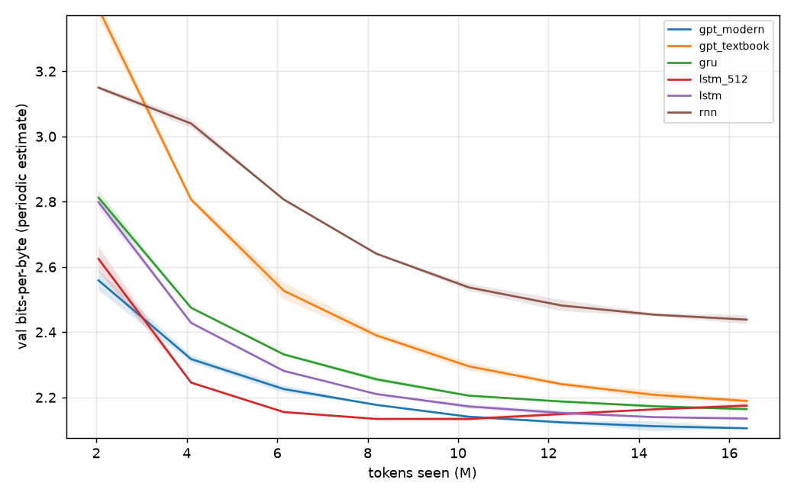
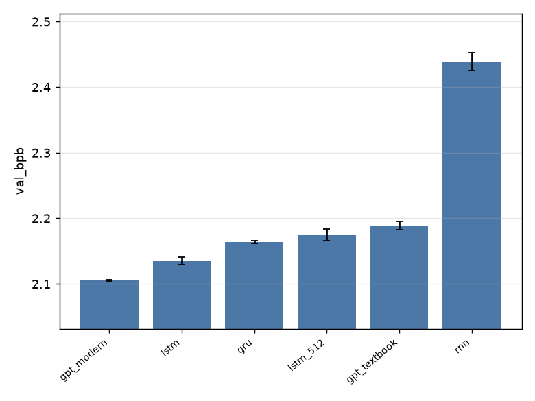
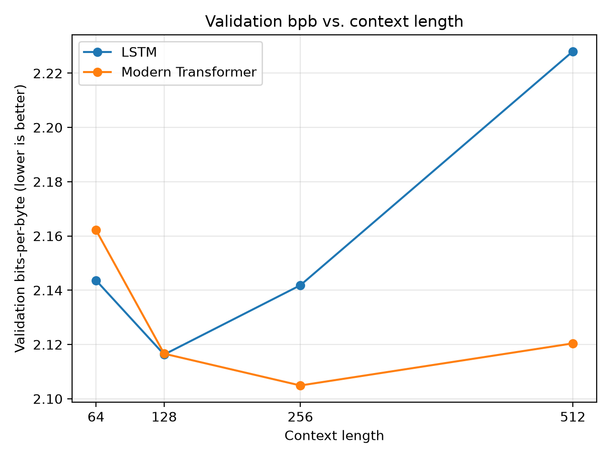

# Homework 1: Language Models from Scratch

## Summary

This report studies character-level language models trained on Tiny Shakespeare. The experiments compare a vanilla RNN, GRU, LSTM, a larger LSTM, a textbook Transformer, and a modern Transformer. They also test context length and inspect attention patterns.

Supporting code, configurations, metrics, and figures: [github.com/jainish1p-code/nanoLLM](https://github.com/jainish1p-code/nanoLLM).

The main results are:

- The vanilla RNN performs worst at 2.4384 validation bits per byte (bpb).
- Gated recurrent models close most of the gap: GRU reaches 2.1639 bpb and LSTM reaches 2.1351 bpb.
- The modern Transformer is best at 2.1052 bpb.
- The larger LSTM is worse than the smaller LSTM despite having about four times as many parameters.
- The LSTM benefits from increasing context to 128 characters, while the modern Transformer benefits through 256 characters.

## Experimental setup

The corpus was Tiny Shakespeare. The final 10% was used for validation, with a fixed character tokenizer of 65 symbols. Architecture comparisons used two seeds, 1337 and 42, and the same budget of 2,000 steps × 32 sequences × 256 characters = 16,384,000 training tokens per run. Training used AdamW and bfloat16 CUDA training on an NVIDIA GRID A100X-10C with 8 CPU cores and 29 GB RAM. Transformer compilation was disabled for the context experiment because the Jetstream2 virtual GPU did not support the default expandable CUDA allocator mode.

The metric is validation bits per byte (bpb), where lower is better. For character data, one token covers one UTF-8 byte in this corpus, so bits/token and bpb are equal. Each run saved its configuration, metadata, logs, metrics, and checkpoint; checkpoints are not included in the submitted artifact.

## 1. Metrics by hand

For a model with validation loss \(L\) in nats/token:

\[
\text{perplexity}=e^L,
\qquad
\text{bits/token}=L/\ln 2,
\]

and

\[
\text{bpb}=\frac{L}{\ln 2}\times\frac{N_{tokens}}{N_{bytes}}.
\]

For the trained character smoke run, the values were:

| Quantity | Recomputed | Logged |
|---|---:|---:|
| Validation loss | 2.653675 | 2.653675 |
| Perplexity | 14.206154 | 14.206154 |
| Bits/token | 3.828444 | — |
| Bits/byte | 3.828444 | 3.828444 |

The values match. The bpb equals bits/token because the character tokenizer covers one byte per token here.

I also trained each tokenizer for one optimizer step to approximate an untrained model. A uniform model over a vocabulary of size \(V\) has loss \(\ln V\).

| Tokenizer | Vocabulary | Loss | \(\ln V\) | Perplexity | bpb |
|---|---:|---:|---:|---:|---:|
| Character | 65 | 4.1601 | 4.1744 | 64.08 | 6.0018 |
| Byte | 256 | 5.4435 | 5.5452 | 231.24 | 7.8533 |

Both one-step losses are close to the uniform baselines. The byte model has a larger per-token loss because it chooses among 256 symbols rather than 65. This does not mean it is necessarily worse: token-level losses use different units. Bits per byte is the fair cross-tokenizer measure.

## 2. RNN, GRU, LSTM, and Transformer comparison

The following results are means over two seeds. Every model saw the same 16.384 million training characters.

| Model | Parameters | Mean bpb | Std. dev. | Training time (min) |
|---|---:|---:|---:|---:|
| Modern Transformer | 3.163M | 2.1052 | 0.0012 | 0.59 |
| LSTM, 2 × 256 | 1.070M | 2.1351 | 0.0057 | 0.67 |
| GRU, 2 × 256 | 0.807M | 2.1639 | 0.0017 | 0.62 |
| LSTM, 2 × 512 | 4.237M | 2.1747 | 0.0088 | 0.57 |
| Textbook Transformer | 3.438M | 2.1891 | 0.0059 | 0.42 |
| Vanilla RNN, 2 × 256 | 0.280M | 2.4384 | 0.0136 | 0.12 |





### Why does the vanilla RNN fall behind?

The vanilla RNN repeatedly updates one hidden state using the previous hidden state. During backpropagation through many characters, gradients are repeatedly multiplied by recurrent transformations. They can vanish or explode, making it difficult to preserve information over long distances. The result is visible in both the final score and the curve: the RNN finishes at 2.4384 bpb, about 0.2493 bpb worse than the textbook Transformer and much worse than the gated recurrent models.

GRU and LSTM gates provide learned paths for retaining or overwriting information. Their scores improve to 2.1639 and 2.1351 bpb, respectively, showing that the gating mechanism addresses much of the long-range optimization problem.

### Is the larger LSTM better or worse?

The larger LSTM is worse in this experiment. The 2 × 512 model has 4.237M parameters versus 1.070M for the 2 × 256 model, but its mean bpb is 2.1747 instead of 2.1351. Its larger capacity does not compensate for the fixed data and optimization budget. The larger model likely begins fitting the small corpus more aggressively without learning a proportionally better general representation. This is a reminder that parameter count alone does not guarantee better validation performance.

The difference is larger than the small-model seed variation, but it should still be interpreted cautiously because only two seeds were used.

### Transformer comparison

The modern Transformer is best at 2.1052 bpb. It uses RMSNorm, RoPE, SwiGLU, and no bias, while the textbook Transformer uses LayerNorm, learned positions, GELU, and the older recipe. Thus this result compares complete deployed configurations, not architecture in isolation. The recipe matters: the modern Transformer beats the textbook Transformer by 0.0839 bpb under the same data and token budget.

## 3. Context length

The context experiment kept the training-token budget fixed at 16.384 million tokens by changing the number of steps as the sequence length changed.

| Model | 64 | 128 | 256 | 512 |
|---|---:|---:|---:|---:|
| LSTM | 2.1437 | **2.1163** | 2.1418 | 2.2280 |
| Modern Transformer | 2.1622 | 2.1166 | **2.1049** | 2.1204 |



The LSTM benefits from 64 to 128 characters, then stops benefiting. Its bpb rises at 256 and rises further at 512. The modern Transformer improves from 64 through 256 characters and reaches its best score at 256; it is slightly worse at 512. Therefore, the modern Transformer uses longer context more effectively in this experiment, although neither model benefits indefinitely.

These results are descriptive rather than a universal context limit. The fixed corpus is small, and the context runs used one seed. Longer sequences also change the number of optimizer steps and the optimization dynamics even though the total token budget is held constant.

## 4. Attention analysis

Attention was inspected using the best context run, the modern Transformer at context length 256, on dialogue, ordinary prose, and speaker-label text. The visualizations are saved as:

- `outputs/nanolm/attention_dialogue.png`
- `outputs/nanolm/attention_prose.png`
- `outputs/nanolm/attention_speaker.png`

The layer and head indices below are zero-based. The numerical analysis averaged attention on the immediately previous character and, separately, on the first character of the current word.

### Previous-token heads

Layer 2, head 2 is a strong previous-token head:

| Text | Average attention on previous character |
|---|---:|
| Dialogue | 61.5% |
| Prose | 57.9% |
| Speaker text | 59.9% |

This behavior is useful for character-level continuation because the immediately preceding character strongly constrains spelling, punctuation, and local syntax.

### Word-start heads

Layer 3, head 3 assigns 32.1% average attention to the first character of the current word in the dialogue example. In the speaker example, layer 2, head 3 assigns 32.9% to the word-start position. The prose example also shows strong word-start behavior: layer 3, head 3 assigns 32.4%, while layer 2, head 2 assigns 32.8%.

These heads can help the model spell the remainder of a word after its first character. The values are averages over the selected short texts, so they support an interpretation of the heads but do not prove that the heads have only one function.

## Conclusions

The experiments show three practical differences between recurrent and attention-based language models. First, the vanilla RNN has difficulty carrying useful information through long character sequences, while gates in GRU and LSTM improve optimization and memory. Second, more parameters can hurt when the training corpus and token budget are fixed: the larger LSTM is worse than the smaller one. Third, the modern Transformer makes better use of longer context than the LSTM in this setup, improving through 256 characters rather than peaking at 128.

The strongest model in the architecture comparison is the modern Transformer at 2.1052 bpb. However, the difference between nearby results should not be exaggerated: the study used two seeds, and the analyzer reported a median within-experiment noise floor of 0.0058 bpb. All conclusions are limited to Tiny Shakespeare, the selected model sizes, the training recipe, and the fixed compute budget.

## Reproducibility

The main commands were:

```bash
python -m pytest nanolm/tests -q
python -m nanolm.train -c nanolm/configs/00_smoke.yaml
python -m nanolm.sweep --sweep nanolm/configs/sweeps/01_char_models.yaml --set train.compile=false
python -m nanolm.analyze outputs/nanolm/sweeps/char_models --baseline gpt_textbook --metric val_bpb
python -m nanolm.viz attention --run <run> --text "..."
```

The architecture sweep used seeds 1337 and 42. Context runs used sequence lengths 64, 128, 256, and 512 with a fixed 16.384M-token budget. The code, configurations, logs, metrics, CSV files, and figures are included with the supporting project files. Datasets, virtual environments, and model checkpoints are excluded.

